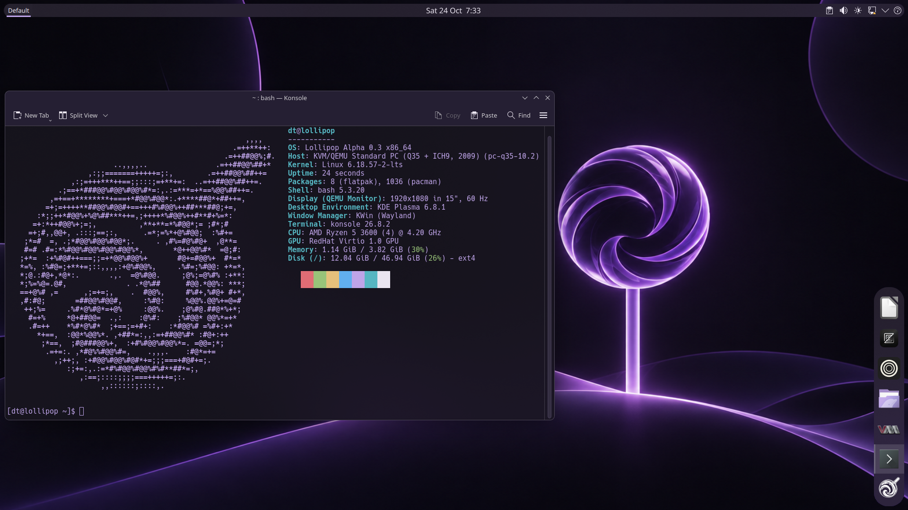

# Lollipop (Repo under construction)
an Arch-based GNU/Linux distribution featuring KDE Plasma, for personal usage only.

## Status
Lollipop is extremely experimental and you shouldn't install it on your device. 
Live-iso is configured and it works fine, do not go far beyond it for now.

## Technical specifications

| Component | Details |
|---|---|
| Development status | Alpha 0.3 |
| Base distribution | Arch Linux |
| Architecture | x86_64 |
| Kernel | Linux 6.18.57-2-lts |
| Desktop environment | KDE Plasma 6.8.1 |
| Display protocol | Wayland |
| Window manager | KWin |
| Package management | Pacman and Flatpak / Flathub |
| Installer | Calamares |
| Live ISO tooling | Archiso |
| Installed system bootloader | GRUB |
| Supported root filesystems | Btrfs and ext4 |
| Compressed swap | Zram |
| Default terminal | Konsole |
| Default shell | Bash |

## Project documentation

- [Architecture](docs/architecture.md)
- [Package inventory](packages/README.md)
- [Desktop defaults and artwork preparation](docs/desktop-defaults.md)
- [Package commands, updates, and recovery](docs/updates.md)
- [Installer integration](docs/installer.md)
- [Archiso live profile](docs/live-profile.md)

## Packaging

- [lollipop-system](packaging/lollipop-system/README.md) — Alpha 0.3 package recipe, complete payload preparation, and standalone build instructions.

- [lollipop-decoration](packaging/lollipop-decoration/README.md) — rounded KWin window decoration derived from Breeze 6.8.1.

- [Calamares](packaging/calamares/README.md) — pinned Qt 6 installer and Lollipop integration.

- [PhotoCraft](packaging/photocraft-bin/README.md) — pinned native photo editor package.
- [Upscayl](packaging/upscayl-bin/README.md) — pinned native image upscaler package.

## License

Original Lollipop code and documentation are licensed under [GNU GPLv3](LICENSE) (`GPL-3.0-only`). Artwork and third-party components have separate terms; see [licensing scope](LICENSES.md).
